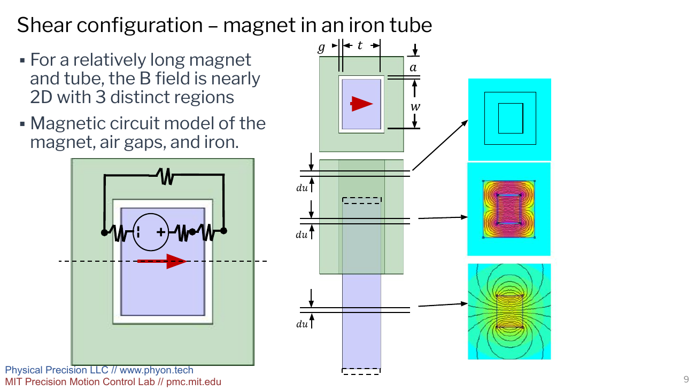

# Overview of Passive Magnetic Springs

In precision machines, there are many places where a constant force is required. An example of this is a vertical stage, where the actuator should not have to carry a load, but should instead be suppressing disturbances/accelerations. Some conventional methods include mechanical springs, counterweights, and pneumatics, but come at the cost of their own dynamics. Additionally, they cannot be used in a vacuum chamber.

An elegant solution is to provide this force from a permanent magnet: by placing a horizontally poled magnet into a ferro-magnetic tube (Fig. 1), a nearly constant force may be obtained over a majority of the length.

The magnetic field near the ends of the magnet and iron becomes a complicated 3d distribution, but a simple expression can be developed for the force produced over a majority of the travel. The easiest way, is by considering the difference between energies in 2 crosssections of the system.

For every distance du that the magnet is displaced out of the tube, the work done is the difference between the energy in the lower and upper section (Fig. 1). The energy in the cross section of the magnet outside the tube can be found from known formulas. The energy in a crosssection within the tube can be estimated from a magnetic circuit. The difference between these energies per du is the force.

An alternative to the methods above is to use 2d FEA for the cross section. I developed a [python FEMM wrapper](../post5/femmWrapper.qmd) for a 2d FEA simulation and used it to generate many of the results in the [conference paper](https://mechanicsandmachines.com/?p=777){target="_blank"}. I also assisted in taking measurements of a similar setup that exhibited hysteresis as can be seen [here](../post12/magneticHystMeasurements.qmd)

{#fig-sections width=100% fig-alt="Presentation slide showing a rectangular magnet entering an iron tube, three cross-sectional regions, a magnetic circuit, and two-dimensional flux plots."}
