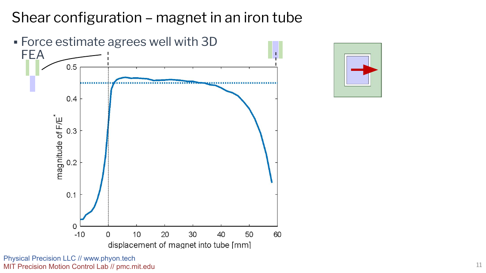
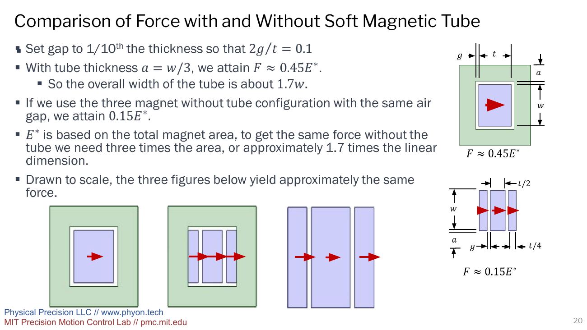
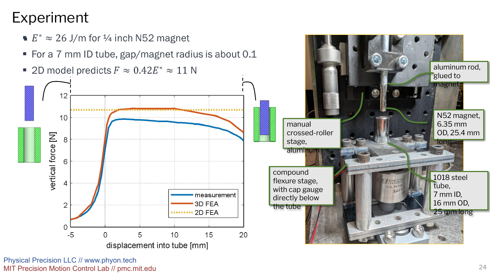
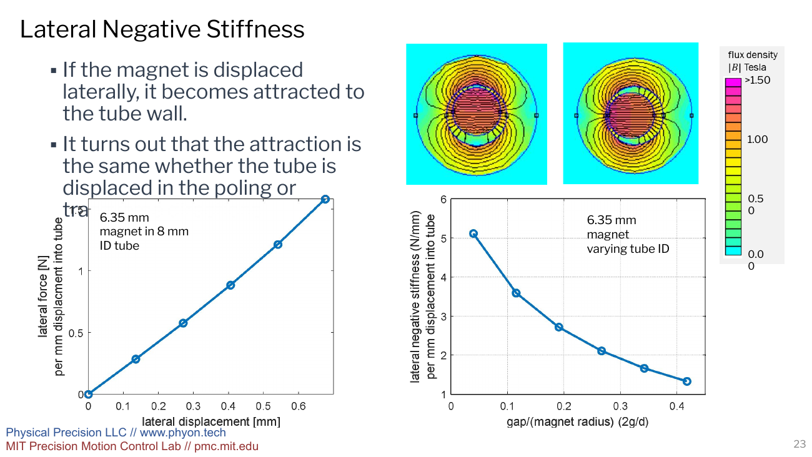

# Overview

In precision machines, there are many places where a constant force is required. An example of this is a vertical stage, where the actuator should not have to carry weight (load) but should instead be suppressing disturbances/accelerations. Some conventional methods include mechanical springs, counterweights, and pneumatics; but these methods have their own dynamics and are not suitable for precision motion---especially in a vacuum chamber.

An eleagant solution is to provide this force from a permanent magnet; by placing a horizontally poled (Fig. 1) magnet into a ferro-magnetic tube, a nearly constant force may be obtained over a majority of the length of overlap as shown (excluding entrance/exit).

The magnetic field near the ends of the magnet and iron is a complicated 3d distribution, but we can develop a simple expression for the force produced over a majority of the travel by considering the difference among energies in 2 different crosssections of the system.

For every distance $ du $ that the magnet is pulled out of the tube, the energy increases by the difference between the energy in the lower and upper section as can be seen in Fig. 1. The energy in the external magnet can be found from known formulas, or from a 2d FEA. The energy in a crosssection within the tube can be estimated from a magnetic circuit, or from 2d FEA. The difference between these energies per $ du $ is the force. 

The details of this analysis (for this case and several others) is shown in the [conference paper](https://mechanicsandmachines.com/?p=777){target="_blank"} [FEA analysis](../post5/femmWrapper.qmd)

### The design problem

One priority in this model was a force-displacement relationship that under load and gravity would remain relatively unchanged. One way to accomplish this is a long permanent magnet that slides through a tube. The magnet is polarized across its cross section, perpendicular to its direction of motion. (EXPLAIN MORE WHY THIS IS A GOOD SOLUTION)

{#fig-sections width=100% fig-alt="Presentation slide showing a rectangular magnet entering an iron tube, three cross-sectional regions, a magnetic circuit, and two-dimensional flux plots."}

Given a long enough tube, it can be shown as a cross section without regarding the end behaviors.

### Theory

Let (E_0) be magnetic energy per unit length (of the magnet outside the tube), and let (E_1) be the energy per unit length (of the magnet inside the tube). Both have units of joules per meter. 

As the magnet moves forward by du, a slice of the cross section changes to match the inside state. Therefore, axial force can be represented by

$$
F \approx E_0-E_1.
$$

THe total energy can be written as a sum of the regions. So icnreasing the overlap between the two magnets transfers eneergy from the outside region to the inside region. We can then diffrentiate energy with respect to displacement to get the difference. Because its energy per unit length, there is no need for magnet length to be considered.

For the rectangular tube model, the air-gap flux density is approximated with a magnetic circuit:

$$
B = B_r\frac{t/\mu_r}{t/\mu_r+2g},
$$

where (B_r) is the magnet remanence, (t) is its dimension along the poling direction, (g) is the one-sided air gap, and (mu_r) is the magnet recoil relative permeability. This relation assumes that the iron provides a sufficiently permeable return path.

Normalizing by the reference energy per length now gives

$$
E^*=\frac{B_r^2tw}{2\mu_r\mu_0},
$$

where (w) is the other cross-sectional dimension and (mu_0) is the permeability of free space.

### Considering the entrance and exit

The cross-sectional estimate has no entrance or exit, so it predicts a constant force. A 3D model restores those end effects.

{#fig-fea width=100% fig-alt="Presentation slide comparing a constant normalized force estimate with a displacement-dependent three-dimensional finite-element curve."}

In this simulated curve, force spikes as the magnet enters the tube, then flattens out once inside the device, then drops as the magnet approaches the exit of the tube. In the case of the iron, if the wall has enough mass to remain below saturation, a magnetic circuit may provide an estimate of the energies. In the case where the iron saturates, the energy on the inside increases which throws off the relationship we seek.

### Iron vs ironless design
Soft iron concentrates flux which increases force for a given set up but also introduces saturation and hysteresis. An ironless design would remove the hysteretic complications but would require more magnetic material to produce the same force.

{#fig-packaging width=100% fig-alt="Presentation slide comparing iron-backed, split-magnet iron-backed, and enlarged ironless magnetic spring cross sections."}

For the comparison shown above, the iron design produces 3x more force given the same amount of magnetic material. Because E scales with cross sectional area, this corresponds to a factor of (sqrt{3}\approx1.7).

This is a tradeoff and the choice would come down to whether the priority is compactness or precision.

### The experiment

The physical test used a diametrically poled N52 cylindrical magnet: its magnetization points across the diameter rather than along its axis. The magnet was 6.35 mm in diameter and 25.4 mm long. It moved into a 25 mm-long 1018-steel tube with a 7 mm inner diameter and a 16 mm outer diameter.

For a circular magnet of diameter (d)

$$
E^*=\frac{\pi d^2B_r^2}{8\mu_r\mu_0}, \qquad \frac{E_0}{E^*}=\frac{1}{2},
$$

and obtains (E_1/E^*) from 2D FEMM analysis. The reference scale for the test magnet is (E^*\approx26\ \mathrm{J/m}). The diameters imply a radial clearance of 0.325 mm.

{#fig-experiment width=100% fig-alt="Presentation slide with a force-versus-insertion plot and photograph of the cylindrical magnetic spring experiment."}

### Lateral stability issue

The tube attracts an off-center magnet toward the nearest wall. That is a negative lateral stiffness: a small radial displacement produces a force that increases the displacement instead of restoring the magnet to center.

{#fig-lateral width=100% fig-alt="Presentation slide showing off-center magnetic flux fields, lateral force, and lateral negative stiffness for a cylindrical magnet in a tube."}

In the circular example, the same attraction for offsets parallel and transverse to the poling direction. Increasing the air gap reduced this destabilizing stiffness, but also reduced axial force. Bearings, flexures, or another guidance mechanism must therefore guide the lateral load. A nearly flat axial force curve may not be interpreted as self-centering behavior.
