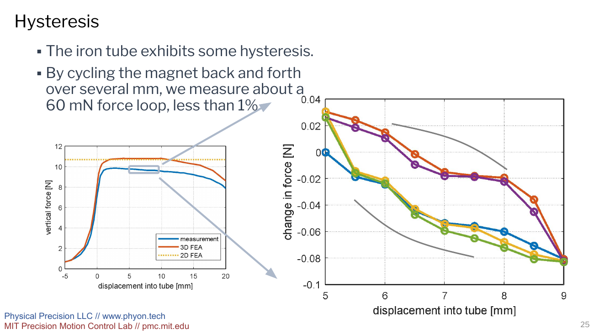

# Designing Passive Magnetic Springs with Energy-Based Models

A vertical actuator should not have to spend energy continuously just to hold up a payload. A passive spring can carry that static load, leaving the actuator to handle motion and disturbance rejection. Conventional springs can do this, but their force usually changes with displacement. A well-designed magnetic spring can instead provide a nearly constant force over a useful range of travel, without contact between its moving parts.

By utilizing the difference in magnetic energy between two cross sections, force may be estimated. That produces a useful design model before the expense of a full three-dimensional finite-element analysis (FEA). We then test the approach against 3D simulations and a physical cylindrical-magnet experiment.

### The design problem

A magnetic spring is not useful merely because two magnets attract or repel. Its force-displacement curve must suit the mechanism around it. For gravity compensation, the desired behavior is often a force that changes very little across the operating stroke.

The presentation surveys several ways to create that behavior: normal-force arrangements, shear arrangements, iron-backed and ironless designs, magnet arrays, and push-pull configurations. It also highlights the quantities that a force-only design can miss: lateral stiffness, hysteresis, damping, temperature sensitivity, moving mass, and package size.

The clearest example is a long permanent magnet that slides axially into a soft-magnetic tube. The magnet is polarized across its cross section, so this is a shear configuration: axial motion changes the overlap between magnet and tube without changing the radial air gap.

{#fig-sections width=100% fig-alt="Presentation slide showing a rectangular magnet entering an iron tube, three cross-sectional regions, a magnetic circuit, and two-dimensional flux plots."}

If the magnet and tube are sufficiently long, most of the device can be represented by three cross sections: an empty tube, a magnet inside the tube, and a magnet outside the tube. Only the entrance and exit are strongly three-dimensional. This separation is what makes the energy method practical.

### Force from energy per unit length

Let (E_0) be the magnetic energy per unit axial length of the magnet outside the tube, and let (E_1) be the corresponding energy per unit length with the magnet inside the tube. Both have units of joules per meter, which is dimensionally equivalent to newtons.

As the magnet advances by a small distance (du), one cross-sectional slice changes from the outside state to the inside state. The presentation therefore estimates the axial force magnitude as

$$
F \approx E_0-E_1.
$$

A useful interpretation is to write the total magnetic energy as a sum of the two regions. Increasing the overlap transfers length from the (E_0) region to the (E_1) region, so differentiating energy with respect to displacement produces their difference. No extra magnet length belongs in the force equation because each (E_i) is already an energy *per unit length*.

For the rectangular tube model, the air-gap flux density is approximated with a magnetic circuit:

$$
B = B_r\frac{t/\mu_r}{t/\mu_r+2g},
$$

where (B_r) is the magnet remanence, (t) is its dimension along the poling direction, (g) is the one-sided air gap, and (mu_r) is the magnet recoil relative permeability. This relation assumes that the iron provides a sufficiently permeable return path. Thin or saturated iron violates that simplifying assumption.

The presentation normalizes results by the reference energy per unit length

$$
E^*=\frac{B_r^2tw}{2\mu_r\mu_0},
$$

where (w) is the other cross-sectional dimension and (mu_0) is the permeability of free space. For the illustrated rectangular example, the stated values are (E^*=101\ \mathrm{J/m}), (E_0=0.55E^*=56\ \mathrm{J/m}), and (E_1=0.09E^*=9.1\ \mathrm{J/m}). Their rounded difference gives an **estimated** force of about (47\ \mathrm{N}). It is not an experimental result.

### Why the force is flat only over part of the stroke

The cross-sectional estimate has no entrance or exit, so it predicts a constant force. A 3D model restores those end effects.

{#fig-fea width=100% fig-alt="Presentation slide comparing a constant normalized force estimate with a displacement-dependent three-dimensional finite-element curve."}

In the simulated curve, force rises as the magnet enters the tube, stays near (0.45E^*) across an intermediate region, and then falls as the magnet approaches the other end. The analytical estimate is therefore most useful for sizing the plateau force. Travel limits and end behavior still need a 3D calculation or a measurement.

The same division of labor applies to the iron. If the wall is thick enough to remain below strong saturation, a magnetic circuit provides a quick estimate of (E_1). If the wall is too thin, local saturation increases the energy of the inside state and reduces the plateau force. The presentation recommends obtaining (E_1) from 2D FEA in that case.

For the studied N52 magnet and 1018-steel rectangular geometry, the simulated force approaches a plateau once the wall thickness is about one-third of the magnet width. Larger air gaps reduce force. That one-third value is a configuration-specific sizing observation, not a universal rule for other steels, magnet grades, or geometries.

### Iron-backed and ironless designs

Soft iron concentrates flux and increases force for a given magnet cross section, but it also brings saturation and hysteresis. An ironless design removes that major hysteretic material at the cost of more magnet volume for the same force.

{#fig-packaging width=100% fig-alt="Presentation slide comparing iron-backed, split-magnet iron-backed, and enlarged ironless magnetic spring cross sections."}

For the particular comparison shown, with (2g/t=0.1) and iron wall thickness (a=w/3), the iron-backed design produces approximately (0.45E^*). A three-magnet ironless layout produces approximately (0.15E^*) when normalized by the same total magnet area. Because (E^*) scales with magnet cross-sectional area, about three times the magnet area can recover similar force. If both linear dimensions are scaled together, that corresponds to a factor of (sqrt{3}\approx1.7).

This is a packaging tradeoff, not a general claim that the alternatives have identical mass, cost, thermal behavior, or lateral stiffness. The design choice depends on whether compactness or low hysteresis matters more.

### The cylindrical experiment

The physical test used a diametrically poled N52 cylindrical magnet: its magnetization points across the diameter rather than along its axis. The magnet was 6.35 mm in diameter and 25.4 mm long. It moved into a 25 mm-long 1018-steel tube with a 7 mm inner diameter and a 16 mm outer diameter.

For a circular magnet of diameter (d), the presentation uses

$$
E^*=\frac{\pi d^2B_r^2}{8\mu_r\mu_0}, \qquad \frac{E_0}{E^*}=\frac{1}{2},
$$

and obtains (E_1/E^*) from 2D FEA. The reported reference scale for the test magnet is (E^*\approx26\ \mathrm{J/m}). The diameters imply a radial clearance of

$$
g=\frac{7-6.35}{2}=0.325\ \mathrm{mm},
$$

so (2g/d\approx0.102). This ratio is arithmetic derived from the stated dimensions, not a separate measurement.

{#fig-experiment width=100% fig-alt="Presentation slide with a force-versus-insertion plot and photograph of the cylindrical magnetic spring experiment."}

The different evidence types should not be collapsed into one number:

| Result | Method | What the presentation shows |
|---|---|---|
| (F\approx0.42E^*\approx11\ \mathrm{N}) | 2D model | A stated constant-force prediction |
| Peak/plateau near (11\ \mathrm{N}) | 3D FEA | A displacement-dependent simulated curve with end effects |
| Plateau roughly (10\ \mathrm{N}) | Physical measurement | An approximate visual reading of the plotted blue trace, which gradually declines with insertion |
| About (60\ \mathrm{mN}), less than 1% | Physical measurement | The reported width of a force hysteresis loop over several millimeters of cycling |

The measurement confirms the intended order of magnitude and the existence of a broad force plateau. The plot does not provide raw data or uncertainty bounds, so it does not support an exact model-error percentage. The reported “less than 1%” refers to the measured hysteresis loop, not to agreement between simulation and experiment.

{#fig-hysteresis width=100% fig-alt="Presentation slide showing the experiment's full force curve and a magnified measured hysteresis loop."}

### Constant axial force does not mean lateral stability

The tube attracts an off-center magnet toward the nearest wall. That is a negative lateral stiffness: a small radial displacement produces a force that increases the displacement instead of restoring the magnet to center.

{#fig-lateral width=100% fig-alt="Presentation slide showing off-center magnetic flux fields, lateral force, and lateral negative stiffness for a cylindrical magnet in a tube."}

In the circular example, the presentation reports the same attraction for offsets parallel and transverse to the poling direction. Increasing the air gap reduces this destabilizing stiffness, but also reduces axial force. Bearings, flexures, or another guidance mechanism must therefore react the lateral load. A nearly flat axial force curve should never be interpreted as self-centering behavior.

### What remains open

The work establishes a compact route from magnetic energy to preliminary spring sizing and demonstrates it on one cylindrical prototype. It does not claim perfectly constant force, zero hysteresis, stability in every direction, or universal wall-thickness rules.

The presentation identifies misalignment, temperature variation, parasitic stiffness, Halbach arrangements, hysteresis prediction, and actuator integration as continuing work. Those are exactly the issues that separate a promising force curve from a complete gravity-compensation mechanism.

## Source

Justin M. Verdirame, Byron Seaberg, Yoonsik Kwon, Kareem S. Nayfeh, David L. Trumper, and Samir A. Nayfeh, **“A Survey of Passive Magnetic Springs,”** 40th ASPE Annual Meeting, San Diego, California, November 5, 2025. Slide footer organizations and sites: Physical Precision LLC ([phyon.tech](https://www.phyon.tech/)) and MIT Precision Motion Control Lab ([pmc.mit.edu](https://pmc.mit.edu/)).

The equations, numerical results, and slide images in this article come from that presentation. Explanatory derivations and dimension arithmetic are identified in the text; approximate plot readings are not substitutes for raw data.
