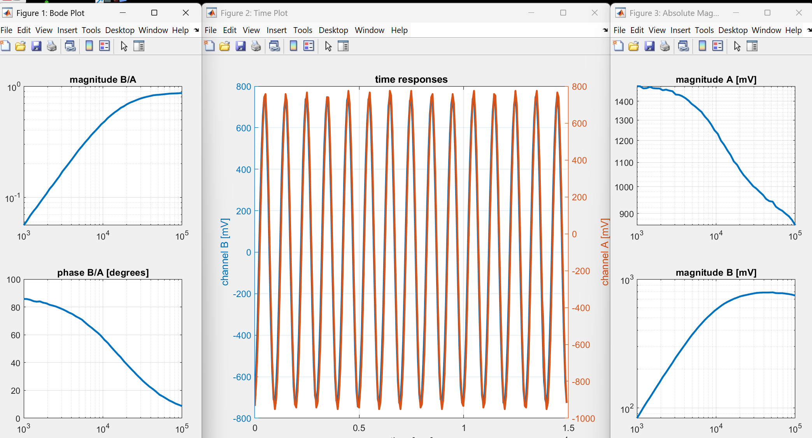

# FRA to Display Custom Results from USB Oscilliscope in Matlab

When utilizing the Picoscope 2204A, the picoscope app's results can be difficult to understand and even exclude useful infortmation. This matlab interpreter ranges the frequencies of a forcing function automatically and allows for any data that the device retrieves to be used. In this case specifically, the following was output:



```julia

close all; clear all; set(0,'defaultlinelinewidth',2)

npts = 50;
fmin = 1000;
fmax = 100000;
freqList = logspace(log10(fmin),log10(fmax),npts);
A0 = 3000;
A1 = 3000;
% amplitude of excitation in peak-to-peak mV 
ampList = A0 + (A1-A0)*(freqList-fmin)/(fmax-fmin); 
% number of periods over which to integrate for each frequency
numPeriodList = 15*ones(npts,1);
% number of samples per period for each frequency
numSamplesPerPeriodList = 15*ones(npts,1);

freqRespMeasure(freqList,ampList,numPeriodList,numSamplesPerPeriodList);


%% ---------------------
function [freq,magBA,phaseBA,Ac,Bc] = freqRespMeasure(freqList,ampList,numPeriodList,numSamplesPerPeriodList)
try
    evalin('base', 'PS2000Config');
    ps2000Enuminfo = evalin('base', 'ps2000Enuminfo');
    ps2000 = icdevice('picotech_ps2000_generic.mdd');
    disp 'connecting'
    connect(ps2000);
    disp(ps2000Enuminfo.enPS2000Range)

    signalGenerator = get(ps2000, 'Signalgenerator');
    signalGenerator = signalGenerator(1);

    blockGroup = get(ps2000, 'Block');
    blockGroup = blockGroup(1);

    invoke(blockGroup, 'getTimebases');
    bodeFig = figure("Name","Bode Plot", "Position",[20, 20, 300, 600]);
    timeFig = figure("Name", "Time Plot", "Position",[320, 20, 600, 600]);
    absMagFig = figure("Name", "Absolute Magnitudes", "Position",[920, 20, 300, 600]);
    nA = 3;
    nB = 3;

    for kk = 1:length(freqList)
        freq(kk) = freqList(kk);
        numPeriods = numPeriodList(kk);
        numSamplesPerWave = numSamplesPerPeriodList(kk);
        set(signalGenerator, 'peakToPeakVoltage', ampList(kk));
        set(signalGenerator, 'startFrequency', freq(kk));
        period = 1/freq(kk);
        blockIntUs = 1e6/freq(kk)/numSamplesPerWave;
        [status.sigGenSimple] = invoke(signalGenerator, 'setSigGenBuiltInSimple', ps2000Enuminfo.enPS2000WaveType.PS2000_SINE);
        [samplingIntervalUs, maxBlockSamples] = invoke(blockGroup, 'setBlockIntervalUs', blockIntUs);
        set(blockGroup, 'timeUnits', ps2000Enuminfo.enPS2000TimeUnits.PS2000_NS);
        numSamples = round(((numPeriods*period/samplingIntervalUs)*1e6));
        set(ps2000, 'numberOfSamples', numSamples)
        disp("getting reasdy to collect...")
        rangeANoGood = true;
        rangeBNoGood = true;
        while(rangeANoGood | rangeBNoGood)
            [status.setChA] = invoke(ps2000, 'ps2000SetChannel', 0, 1, 1, nA);
            [status.setChB] = invoke(ps2000, 'ps2000SetChannel', 1, 1, 1, nB);
            [bufferTimes, bufferChA, bufferChB, numDataValues, timeIndisposedMs] = invoke(blockGroup, 'getBlockData');
            maxA = max(abs(bufferChA));
            maxB = max(abs(bufferChB));
            disp( ['A range=' num2str(numToMv(nA)) ' maxA=' num2str(maxA) ] );
            if (maxA <= numToMv(nA-1) & nA>2)
                nA = nA-1;
                disp(['ranging A down to ' num2str(numToMv(nA))]);
            elseif (maxA==numToMv(nA) & nA<10)
                nA = nA+1;
                disp(['ranging A up to ' num2str(numToMv(nA))]);
            else
                disp('range A fixed');
                rangeANoGood = false;
            end
            disp( ['B range=' num2str(numToMv(nB)), ' maxB=' num2str(maxB) ] );
            if (maxB <= numToMv(nB-1) & nB>2)
                nB = nB-1;
                disp(['ranging B down to ' num2str(numToMv(nB))]);
            elseif (maxB==numToMv(nB) & nB<10)
                nB = nB+1;
                disp(['ranging B up to ' num2str(numToMv(nB))]);
            else
                disp('range B fixed');
                rangeBNoGood = false;
            end
        end

        t = [0: length(bufferChA)-1]'*samplingIntervalUs*1e-6;
        figure(timeFig);
        yyaxis left
        plot(t, bufferChB)
        ylabel('channel B [mV]')
        yyaxis right
        plot(t, bufferChA)
        ylabel('channel A [mV]')
        xlabel('time [sec]')
        grid on; drawnow;
        title('time responses')

        % integrate the signals each against cos and sin
        Breal(kk) = 2*trapz(t, double(bufferChB).*cos(2*pi*freqList(kk)*t))/t(end);
        Bimag(kk) = -2*trapz(t, double(bufferChB).*sin(2*pi*freqList(kk)*t))/t(end);
        Areal(kk) = 2*trapz(t, double(bufferChA).*cos(2*pi*freqList(kk)*t))/t(end);
        Aimag(kk) = -2*trapz(t, double(bufferChA).*sin(2*pi*freqList(kk)*t))/t(end);
        % assemble each into a complex number
        Ac(kk) = Areal(kk)+i*Aimag(kk);
        Bc(kk) = Breal(kk)+i*Bimag(kk);
        % get magnitude and phase
        magBA(kk) = abs(Bc(kk)/Ac(kk));
        phaseBA(kk) = angle(Bc(kk)/Ac(kk));

        figure(absMagFig);
        subplot(2,1,1);
        loglog(freq, abs(Ac))
        grid on;
        title('magnitude A [mV]')
        subplot(2,1,2);
        loglog(freq, abs(Bc))
        grid on;
        title('magnitude B [mV]')

        figure(bodeFig);
        subplot(2, 1, 1);
        loglog(freq, magBA);
        grid on;
        title('magnitude B/A')
        subplot(2, 1, 2);
        semilogx(freq,180/pi*unwrap(phaseBA));
        grid on;
        title('phase B/A [degrees]')
    end

    stopStatus = invoke(ps2000, 'ps2000Stop');
    disconnect(ps2000);
    delete(ps2000);
catch E
    if exist('ps2000','var') && isvalid(ps2000)
        disconnect(ps2000);
        delete(ps2000);
    end
    rethrow(E);
end
end


%%------------------------------------------------------------------------
function [A, B] = getAB(s, t, f)
A = 2*trapz(t, s.*cos(2*pi*f*t))/t(end);
B = 2*trapz(t, s.*sin(2*pi*f*t))/t(end);
end
%%
function n = numToMv(input)
if input == 0
    n = 10;
elseif input == 1
    n = 20;
elseif input == 2
    n = 50;
elseif input == 3
    n = 100;
elseif input == 4
    n = 200;
elseif input == 5
    n = 500;
elseif input == 6
    n = 1000;
elseif input == 7
    n = 2000;
elseif input == 8
    n = 5000;
elseif input == 9
    n = 10000;
elseif input == 10
    n = 20000;
elseif input == 11
    n = 50000;
end
end

```