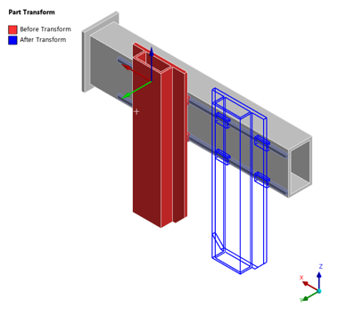
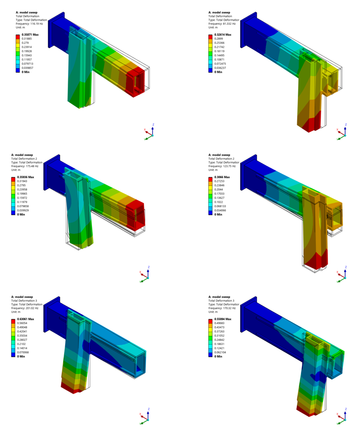

# Finding Mode Shapes and Participation Factors of Multiple Solutions Over a Sequence

There is often a need to solve a simulation with multiple changing parameters such as displacement or spring stiffness. One example of this is when getting mode shapes and participation factors for a machine over its range of motion. 



The code also uses regexp to seperate the natrual frequencies along with the mass participation factors (including animations of the modes)



```python

import numpy as np
from io import StringIO
import sys
import csv
import clr
clr.AddReference("System")
from System import Console

def getParticipationFactors(thisModal):
    import os
    import re
    with open(os.path.join(thisModal.WorkingDir, "solve.out"), "r") as f:
        text = f.read()
    pattern = r"\n\s*\d+\s+[\d.]+\s+[\d.]+E[+-]\d+\s+(-?[\d.?]+E?[+-]?\d*)\s+\d"
    return [float(x) for x in re.findall(pattern, text)]

a = DataModel.GetObjectsByName("Solution")[0].Children
Graphics.ResultAnimationOptions.NumberOfFrames = 8
Graphics.ResultAnimationOptions.Duration = Quantity(3,'s')
FileLoc = r"""K:\animations\l_swp_"""

sModal = [x for x in Model.Analyses if "Modal" in x.Name][0]
data = []
csvPath = r"K:\sweepresults.csv"

displacementList = [0,-0.1,-0.2,-0.3,-0.4,-0.5]
transform = DataModel.GetObjectsByName("Part Transform")[0]

for kk in range(np.size(displacementList)):
    Console.WriteLine('step' + str(kk))
    transform.TranslationX = Quantity(displacementList[kk], "m")
    sModal.ClearGeneratedData()
    sModal.Solve()
    results = sModal.GetResultsData()
    frequencies = list(results.ListTimeFreq)
    numModes = len(frequencies)
    results.Dispose()
    pf = getParticipationFactors(sModal)
    sModal.Solution.EvaluateAllResults()
    a = sModal.Solution.Children
    for x in list(a)[1:3]:
        x.ExportAnimation(FileLoc + str(kk) + x.Name + """.mp4""", GraphicsAnimationExportFormat.MP4)
    pfX  = pf[0 * numModes:1 * numModes]
    pfY  = pf[1 * numModes:2 * numModes]
    pfZ  = pf[2 * numModes:3 * numModes]
    pfRX = pf[3 * numModes:4 * numModes]
    pfRY = pf[4 * numModes:5 * numModes]
    pfRZ = pf[5 * numModes:6 * numModes]
    #ata.append(["Step " + str(kk)])
    for j in range(numModes):
        data.append([
            kk,
            j,
            frequencies[j],
            pfX[j],
            pfY[j],
            pfZ[j],
            pfRX[j],
            pfRY[j],
            pfRZ[j]
        ])
        #data.append([])
    print(frequencies)
    print(data)
    sys.stdout.flush()
    

with open(csvPath, "w", newline="") as f:
    writer = csv.writer(f)
    writer.writerows(data)

```