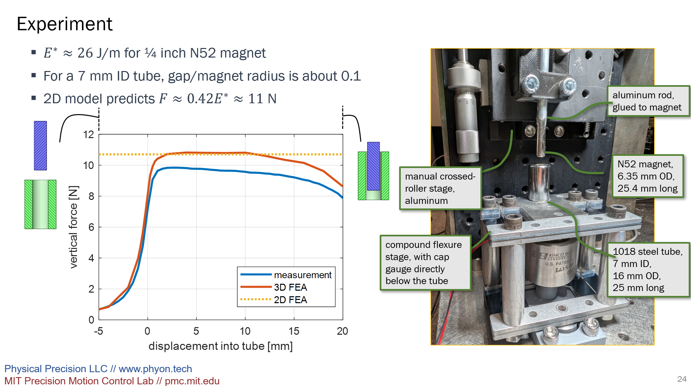
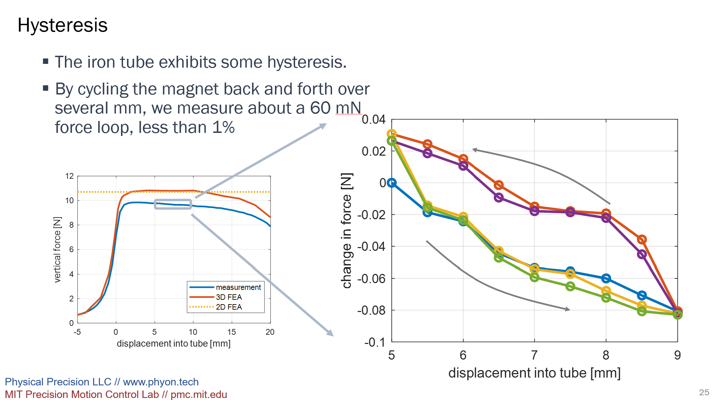

# Measurements of Magnetic-Force Hysteresis in a Passive Magnetic Spring

As described in another [post](../post6/MagneticHysteresisPaper.qmd), I helped develop models for force in magnetic springs formed by a magnet in a metal tube.

The figure below shows the setup and measurement result for a circular magnet in a steel tube with a comparison to the simplified model (2d FEA) as well as a 3d FEA.

By moving the magnet up and down over a 4 mm range and zooming in over the force axis, a hysteresis loop of about 60 mN can be seen.

