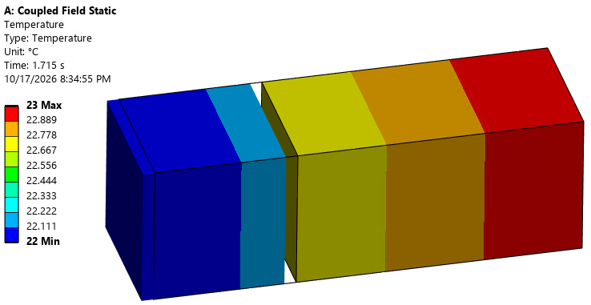

When analyzing heat transfer in ANSYS, there is often times a need to consider thermal conductivity accounting for the conductivity of air despite it being so small. In this case, the bar and cube (10 mm x 10 mm x 20 mm and 10 mm x 10 mm x 10mm) are steel and held at 23 and 22 degrees respectively. Across a small gap, the conduction is not negligible, but may not be treated as if they were touching.




```apdl
k_air = 0.026 ! thermal conductivity of air near room temp (W/m-K)
h_max = 5e4  ! full contact thermal contact conductance (W/m^2-K)
g_max = 5e-3 ! max gap over which to construct the table (m)
n_tcc = 60 ! number of points to include in the table

g_cap = k_air/h_max ! this is the gap below which to hold at g_max

*del,tcc_tab,,nopr
*dim,tcc_tab,table,n_tcc+1,1,1,GAP

! Open gap is negative: rows run from -g_max up to -g_cap
*do,i,1,n_tcc
    ! power-law spacing of gap entries in the tabke
    g = g_max*(g_cap/g_max)**((i-1)/(n_tcc-1)) 
    tcc_tab(i,0) = -g  ! gap is negative in ansys convension
    tcc_tab(i,1) = k_air/g  ! contact conductivity W/m^2-K 
*enddo

tcc_tab(n_tcc+1,0) = 1.0  ! ansys positive gap is actually pushed together
tcc_tab(n_tcc+1,1) = h_max  ! saturate at max contact conductivity

rmodif,cid,14,%tcc_tab%
nldiag,cont,on


```
The tcc table is set up so that at smaller values, the steps are closer together as any function depending on an inverse asymptotically approaches zero as the independant variable increases.