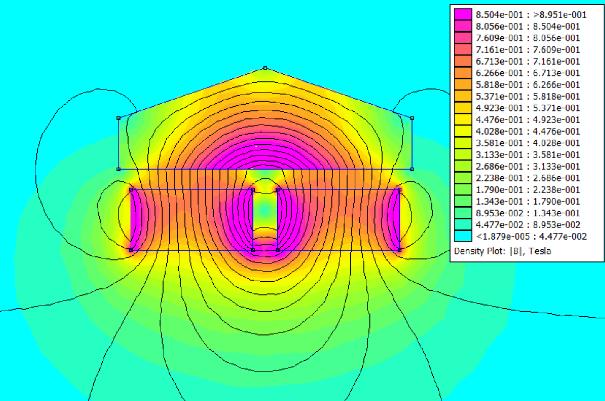
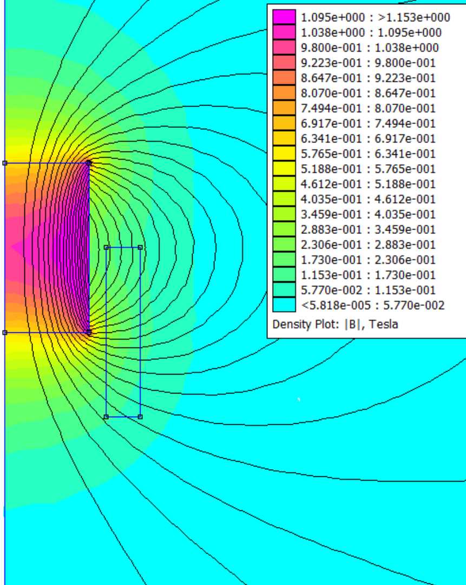

# An Object-Oriented Python Wrapper for FEMM

[Finite Element Method Magnetics (FEMM)](https://www.femm.info/) has a python scripting interface thats commands are procedural, meaning you establish an instance and then edit its attributes line by line before moving onto a seperate instance. This is useable for small scale projects but becomes unreadable and bulky fast. To overcome this, I wrote a small python femm wrapper to automate simulations for a paper I was part of.

By organizing pyFEMM into objects, it becomes significantly easier to construct larger scale models.

### Ex 1





```python
from pyFemmStructs import Model
import numpy as np

magWidth = 12
magHeight = 6
yc = 5

mod1 = Model(depth=50, symmetric=False) # radius is no longer used here
steel = mod1.loadMaterial("1018 Steel")
N52 = mod1.loadMaterial("N52")
air = mod1.loadMaterial("Air")

airOuter = mod1.addBlock(air,'circle', [0,0,60])
magnet1 = mod1.addBlock(N52, 'rectangle center', [-magWidth*0.6,yc,magWidth,magHeight],90)
magnet2 = mod1.addBlock(N52, 'rectangle center', [magWidth*0.6,yc,magWidth,magHeight],-90)
iron = mod1.addBlock(steel,'coordlist',[-1.2*magWidth,10, -1.2*magWidth,15, 0,20, 1.2*magWidth,15, 1.2*magWidth,10 ])
mod1.drawAll()
mod1.solve()
print(iron.getForce())
foo = mod1.getEnergyTable()
print(foo)
```
### Ex 2



```python
from pyFemmStructs import Model
import numpy as np

model1 = Model(symmetric=True) 
N52Linear = model1.createMaterial('N52Linear', 1.05, 1.05, 1109e3)
air = model1.loadMaterial("Air")
cu = model1.loadMaterial("Copper")
airOuter = model1.addBlock(air,'half circle', [80])
magnet = model1.addBlock(N52Linear, 'rectangle corners', [0,0,10,20],90)
circuit1 = model1.addCircuit('circuit1',5,1)
coil1 = model1.addCoil(circuit1,cu, [12,-10,16,10],100,shape='rectangle corners')
model1.drawAll()
model1.solve()
print(coil1.getForce())

```

### The wrapper

One important nuance is that as of now the region must be large enough with respect to the objects to simulate a flux moving to infinity. In the future I hope to implement a boundary condition to allow simulation towards infinity.

```python
import femm
import numpy as np

class Model:
    def __init__(self, depth=1, symmetric=False):
        self.symmetric = symmetric
        self.blocks = []
        self.materials = []
        self.coils = []
        self.circuits = []
        
        femm.openfemm() 
        femm.newdocument(0)
        
        if symmetric:
            femm.mi_probdef(0, 'millimeters', 'axi', 1e-8, 0, 30)
        else:
            femm.mi_probdef(0, 'millimeters', 'planar', 1e-8, depth, 30)
        
    def addBlock(self, material, shape, coords, direction = 0, controlPoint = None, meshSize = None):
        block = Block(self, str(material), shape, coords, direction, controlPoint, meshSize)
        self.blocks.append(block)
        return block
    
    def addCoil(self, circuit, material, coords, turns, shape='rectangle',
                direction=0, controlPoint=None, meshSize=None):
        coil = Coil(self, str(circuit), str(material), coords, turns, shape,
                    direction, controlPoint, meshSize)
        self.coils.append(coil)
        return coil

    def addCircuit(self, circuitName, amps, isSeries=1 ):  
        circuit = Circuit(self,circuitName,amps,isSeries)
        self.circuits.append(circuit)
        return circuit
    
    def drawAll(self):
        for x in self.blocks:
            x.draw()
        for x in self.coils:
            x.draw()
            
    def solve(self):
        femm.mi_saveas('blah.fem')
        femm.mi_analyze()
        femm.mi_loadsolution()
                  
    def getEnergyTable(self):
        Energy = []
        for x in self.blocks:
            Energy.append(x.getEnergy())
        return np.array(Energy)
                          
    def createMaterial(self, matName, ux, uy, hC=0, j=0, cDuct=0, lamD=0, phiHMax=0, lam=0, phiHx=0, phiHy=0, nstr=0, dwire=0):
        material = Material(matName, ux, uy, hC, j, cDuct, lamD, phiHMax, lam, phiHx, phiHy, nstr, dwire, True)
        return material
    
    def loadMaterial(self, matName):
        material = Material(matName)
        return material
    
    def getForceOnBlocks(self,blockList):
        femm.mo_clearblock()
        for theBlock in blockList:
            theBlock.selectBlock()
        # horizontal force, vertical force
        return(femm.mo_blockintegral(18),femm.mo_blockintegral(19))
        
    
class Block:
    def __init__(self, model, material, shape, coords = None, direction = 0, controlPoint = None, meshSize = None):
        self.model = model
        self.shape = shape
        self.material = material
        self.direction = direction
        self.coords = coords
        self.circuit = '<None>'
        self.turns = 0
        if controlPoint is not None:
            self.x = controlPoint[0]
            self.y = controlPoint[1]
            self.autoCenter = False
        else:
            self.autoCenter = True
        if meshSize is not None:
            self.autoMesh = 0
            self.meshSize = meshSize
        else:
            self.autoMesh = 1
            self.meshSize = 0
        
    def getForce(self):
        # this method only works for blocks abutting free space
        femm.mo_clearblock()
        femm.mo_selectblock(self.x, self.y)
        # horizontal force, vertical force
        return(femm.mo_blockintegral(18),femm.mo_blockintegral(19))
    
    def selectBlock(self):
        femm.mo_selectblock(self.x,self.y)
    
    def getEnergy(self):
        femm.mo_clearblock()
        femm.mo_selectblock(self.x, self.y)
        # energy, co-energy
        return(femm.mo_blockintegral(2), femm.mo_blockintegral(17))
    
    def setCoords(self, coords):
        self.coords = coords
    
    def draw(self):
        print(self.shape,self.material)
        if (self.shape == 'coordlist'):
            coords = self.coords
            if len(self.coords)%2 == 0:
                for i in range(0, len(coords), 2): 
                    femm.mi_drawline(coords[i], coords[i+1], coords[(i+2)%len(coords)], coords[(i+3)%len(coords)])
            xMax, yMax = max(coords[::2]), max(coords[1::2])
            xMin, yMin = min(coords[::2]), min(coords[1::2])
            if self.autoCenter:
                self.x,self.y = xMin+0.5*(xMax-xMin), yMin+0.5*(yMax-yMin)
        elif (self.shape == 'circle'):
            # coords: centerx, centery, radius
            centerx,centery,radius = self.coords[0],self.coords[1],self.coords[2]
            femm.mi_drawarc(centerx,centery+radius,centerx,centery-radius, 180, 30)            
            femm.mi_drawarc(centerx,centery-radius,centerx,centery+radius, 180, 30)
            if self.autoCenter:
                self.x,self.y = centerx,centery+0.95*radius
        elif (self.shape == 'half circle'):
            # coords: [radius]; centered at origin, spans -90 to 90 deg, closed along the axis
            r = self.coords[0]
            femm.mi_drawarc(0, -r, 0, r, 180, 1)
            femm.mi_drawline(0, r, 0, -r)
            if self.autoCenter:
                self.x, self.y = 0.025*r, 0.95*r
        elif self.shape in ('rectangle','rectangle center'):
            # coords: centerx, centery, width, height
            centerx,centery,width,height = self.coords[0],self.coords[1],self.coords[2],self.coords[3]
            femm.mi_drawrectangle(centerx-width/2,centery-height/2,centerx+width/2,centery+height/2)
            if self.autoCenter:
                self.x,self.y = centerx+0.49*width,centery+0.49*height
        elif (self.shape == 'rectangle corners'):
            # coords: x1, y1, x2, y2
            femm.mi_drawrectangle(self.coords[0],self.coords[1],self.coords[2],self.coords[3])
            if self.autoCenter:
                width = (self.coords[2]-self.coords[0])
                height = (self.coords[3]-self.coords[1])                
                self.x,self.y = self.coords[0]+0.98*width,self.coords[1]+0.98*height  
        else:
            raise ValueError(f"unknown shape '{self.shape}'")
            
        femm.mi_addblocklabel(self.x, self.y)
        femm.mi_selectlabel(self.x, self.y)
        femm.mi_setblockprop(self.material, self.autoMesh, self.meshSize, self.circuit, self.direction, 0, self.turns)
        femm.mi_clearselected()
        
class Material:
    def __init__(self, matName=None, ux=None, uy=None, hC=None, j=None, cDuct=None, lamD=None, phiHMax=None, lam=None, phiHx=None, phiHy=None, nstr=None, dwire=None, create = False):
        self.matName = matName
        if create:
            femm.mi_addmaterial(matName, ux, uy, hC, j, cDuct, lamD, phiHMax, lam, phiHx, phiHy, nstr, dwire)
        else:
            femm.mi_getmaterial(matName)
            
    def __str__(self):
        return self.matName
    
class Circuit:
    def __init__(self, model,circuitName, amperes, isSeries):
        self.amps = amperes
        self.isSeries = isSeries
        self.circuitName = circuitName
        femm.mi_addcircprop(circuitName, self.amps, self.isSeries)
    def __str__(self):
        return self.circuitName
    
class Coil(Block):
    def __init__(self, model, circuit, material, coords, turns, shape='rectangle',
                 direction=0, controlPoint=None, meshSize=None):
        super().__init__(model, material, shape, coords, direction, controlPoint, meshSize)
        self.circuit = circuit
        self.turns = turns

```