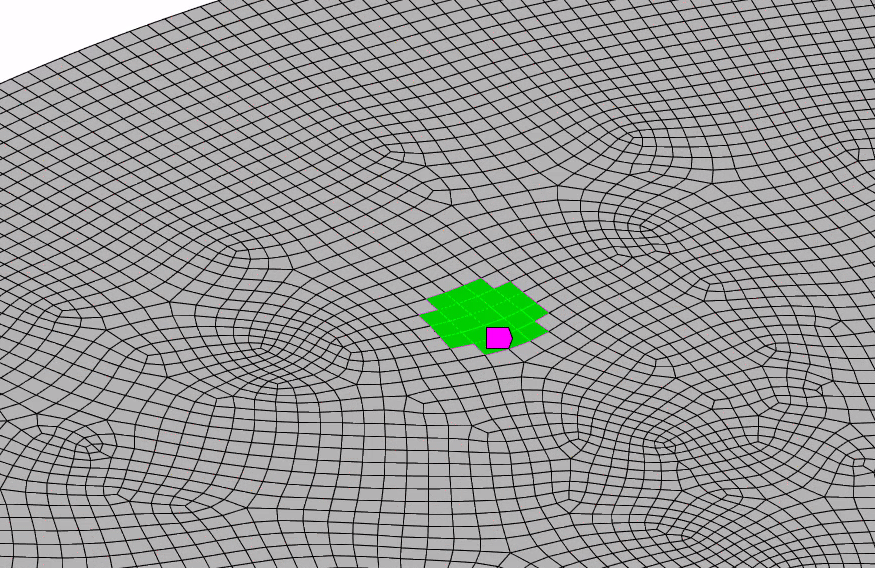

# Selecting Mesh Faces by Position and Normal in ANSYS Mechanical

Selecting elements and element faces is a very powerful tool when it comes to applying various conditions in ANSYS. This page is entirely dedicated to the selection of elements and their faces.

The reason this is so difficult is because while the elements themselves are objects, the faces are abrbitrarily indexed starting from 0. This means that for the exact same setup, the 0th face of a cubic element could be in opposite directions between models. Additionally, there are no normal vectors or centroids provided for these faces, despite them being one of the strongest ways to apply loads during analysis. Using a singular function `getFaceSelectionAtCoords()` now allows us to get a highly accurate circle of elements and the faces on their surface.



The math behind the code can be found at the end of this page!

```python
import numpy as np

eTypeToFaceIndex = {
    ElementTypeEnum.kTri3: [[0, 1, 2]],
    ElementTypeEnum.kTri6: [[0, 1, 2, 4, 5, 6]],
    ElementTypeEnum.kQuad4: [[0, 1, 2, 4]],
    ElementTypeEnum.kQuad8: [[0, 1, 2, 4, 5, 6, 7, 8]],
    ElementTypeEnum.kTet4: [
        [0, 1, 3], [1, 2, 3], [2, 0, 3], [0, 2, 1]
    ],
    ElementTypeEnum.kTet10: [
        [0, 1, 3, 4, 8, 7],
        [1, 2, 3, 5, 9, 8],
        [2, 0, 3, 6, 7, 9],
        [0, 2, 1, 6, 5, 4]
    ],
    ElementTypeEnum.kPyramid5: [
        [0, 3, 2, 1], [0, 1, 4], [1, 2, 4], [3, 4, 2], [0, 4, 3]
    ],
    ElementTypeEnum.kPyramid13: [
        [0, 3, 2, 1, 8, 7, 6, 5],
        [0, 1, 4, 5, 10, 9],
        [1, 2, 4, 6, 11, 10],
        [3, 4, 2, 12, 11, 7],
        [0, 4, 3, 9, 12, 8]
    ],
    ElementTypeEnum.kWedge6: [
        [0, 2, 1], [3, 4, 5], [0, 1, 4, 3],
        [1, 2, 5, 4], [0, 3, 5, 2]
    ],
    ElementTypeEnum.kWedge15: [
        [0, 2, 1, 8, 7, 6],
        [3, 4, 5, 9, 10, 11],
        [0, 1, 4, 3, 6, 13, 9, 12],
        [1, 2, 5, 4, 7, 14, 10, 13],
        [0, 3, 5, 2, 12, 11, 14, 8]
    ],
    ElementTypeEnum.kHex8: [
        [0, 1, 5, 4], [1, 2, 6, 5], [2, 3, 7, 6],
        [3, 0, 4, 7], [0, 3, 2, 1], [4, 5, 6, 7]
    ],
    ElementTypeEnum.kHex20: [
        [0, 1, 5, 4, 8, 17, 12, 16],
        [1, 2, 6, 5, 9, 18, 13, 17],
        [2, 3, 7, 6, 10, 19, 14, 18],
        [3, 0, 4, 7, 11, 16, 15, 19],
        [0, 3, 2, 1, 11, 10, 9, 8],
        [4, 5, 6, 7, 12, 13, 14, 15]
    ]
}

axeDict = {"xy": [0, 1], "xz": [0, 2], "yz": [1, 2]}


def highlight(selection):
    ExtAPI.SelectionManager.NewSelection(selection)


def getMeshData(ns, mesh):
    elementIds = []
    for geoId in ns.Location.Ids:
        elementIds.extend(mesh.MeshRegionById(geoId).ElementIds)

    elementIds = list(set(elementIds))
    elements = [mesh.ElementById(elementId) for elementId in elementIds]
    centroids = np.asarray(
        [list(element.Centroid) for element in elements],
        dtype=float
    )
    return elements, centroids


def getElementAroundCoords(meshData, coords, r, plane="xy"):
    elements, centroids = meshData
    coords = np.asarray(coords, dtype=float)
    axes = axeDict[plane]
    diffs = centroids[:, axes] - coords[axes]
    distSq = np.sum(diffs**2, axis=1)
    keep = distSq <= r**2
    return [element for element, include in zip(elements, keep) if include]


def findMatchingFaces(element, goalVector):
    goalVec = np.asarray(goalVector, dtype=float)
    goalLength = np.linalg.norm(goalVec)
    if goalLength == 0:
        raise ValueError("targetFaceVector cannot be zero")
    goalVec = goalVec / goalLength
    cornerNodes = element.CornerNodes
    matches = []

    for faceIndex, nodeIndices in enumerate(eTypeToFaceIndex[element.Type]):
        p0 = np.array([
            cornerNodes[nodeIndices[0]].X,
            cornerNodes[nodeIndices[0]].Y,
            cornerNodes[nodeIndices[0]].Z
        ])
        p1 = np.array([
            cornerNodes[nodeIndices[1]].X,
            cornerNodes[nodeIndices[1]].Y,
            cornerNodes[nodeIndices[1]].Z
        ])
        p2 = np.array([
            cornerNodes[nodeIndices[2]].X,
            cornerNodes[nodeIndices[2]].Y,
            cornerNodes[nodeIndices[2]].Z
        ])

        normal = np.cross(p1 - p0, p2 - p0)
        normalLength = np.linalg.norm(normal)
        if normalLength == 0:
            continue
        normal = normal / normalLength
        if abs(np.dot(normal, goalVec) - 1) < 1e-3:
            matches.append(faceIndex)

    return matches


def elementsToFaces(elements, targetFaceVector):
    elementIds = []
    faceIndices = []

    for element in elements:
        matches = findMatchingFaces(element, targetFaceVector)
        if matches:
            elementIds.append(element.Id)
            faceIndices.append(matches[0])

    return elementIds, faceIndices


def createFaceSelection(elements, targetFaceVector):
    elementIds, faceIndices = elementsToFaces(elements, targetFaceVector)
    faceSelection = ExtAPI.SelectionManager.CreateSelectionInfo(
        SelectionTypeEnum.MeshElementFaces
    )
    faceSelection.Ids = elementIds
    faceSelection.ElementFaceIndices = faceIndices
    return faceSelection


def getFaceSelectionAtCoords(
    meshData, coords, r, targetFaceVector, plane="xy"
):
    elements = getElementAroundCoords(meshData, coords, r, plane)
    return createFaceSelection(elements, targetFaceVector)


```

### Math behind the code


For an *xy* search, an element with centroid $\mathbf{c}$ is obtained when

$$
(c_x-q_x)^2+(c_y-q_y)^2 \le r^2,
$$

where $\mathbf{q}$ is the search center and $r$ is the radius. Ignoring the third coordinate makes this a cylindrical search through the mesh rather than a spherical one.


Each element type has a different local face definition, so *eTypeToFaceIndex* maps every face to its local node indices. For the first three corner positions $\mathbf{p}_0$, $\mathbf{p}_1$, and $\mathbf{p}_2$, the unit normal is

$$
\hat{\mathbf{n}}=
\frac{(\mathbf{p}_1-\mathbf{p}_0)\times(\mathbf{p}_2-\mathbf{p}_0)}
{\left\|(\mathbf{p}_1-\mathbf{p}_0)\times(\mathbf{p}_2-\mathbf{p}_0)\right\|}
$$

The node order matters because reversing it reverses the normal. The face matches a target direction $\hat{\mathbf{g}}$ when

$$
\left|\hat{\mathbf{n}}\cdot\hat{\mathbf{g}}-1\right|<10^{-3}.
$$

Because the test is near \(+1\), it accepts faces pointing with the target vector, not against it. The tolerance corresponds to roughly \(2.6^\circ\). The resulting element IDs and local face numbers can be assigned directly to a *MeshElementFaces* selection.

The final loop advances the search center in \(x\), creates one heat-flow object at each location, and gives each object a 2000 W peak at its matching time point. Mechanical interpolates between the tabular values, so additional points are needed if a square pulse is required.