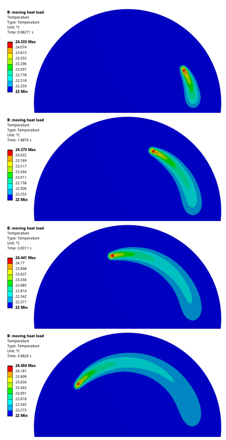

# Applying a Moving Heatload to a Surface in ANSYS Mechanical

Often times when analysing a moving load, it becomes extremely tedious to move said load manually. This code allows for the process to be automated as shown below:



*Note: the logic behind the element face selection process can be found [here](elementFaceSelection.qmd)*

```python
import numpy as np

eTypeToFaceIndex = {
    ElementTypeEnum.kTri3 : [ [ 0, 1, 2 ] ],
    ElementTypeEnum.kTri6 : [ [ 0, 1, 2, 4, 5, 6 ] ],
    ElementTypeEnum.kQuad4 : [ [ 0, 1, 2, 4 ] ],
    ElementTypeEnum.kQuad8 : [ [ 0, 1, 2, 4, 5, 6, 7, 8 ] ],
    ElementTypeEnum.kTet4 : [ [ 0, 1, 3 ], [ 1, 2, 3 ], [ 2, 0, 3 ], [ 0, 2, 1 ] ],
    ElementTypeEnum.kTet10 : [ [ 0, 1, 3, 4, 8, 7 ], [ 1, 2, 3, 5, 9, 8 ], [ 2, 0, 3, 6, 7, 9 ], [ 0, 2, 1, 6, 5, 4 ] ],
    ElementTypeEnum.kPyramid5 : [ [ 0, 3, 2, 1 ], [ 0, 1, 4 ], [ 1, 2, 4 ], [ 3, 4, 2 ], [ 0, 4, 3 ] ],
    ElementTypeEnum.kPyramid13 : [ [ 0, 3, 2, 1, 8, 7, 6, 5 ], [ 0, 1, 4, 5, 10, 9 ], [ 1, 2, 4, 6, 11, 10 ], [ 3, 4, 2, 12, 11, 7 ], [ 0, 4, 3, 9, 12, 8 ] ],
    ElementTypeEnum.kWedge6 : [ [ 0, 2, 1 ], [ 3, 4, 5 ], [ 0, 1, 4, 3 ], [ 1, 2, 5, 4 ], [ 0, 3, 5, 2 ] ],
    ElementTypeEnum.kWedge15 : [ [ 0, 2, 1, 8, 7, 6 ], [ 3, 4, 5, 9, 10, 11 ], [ 0, 1, 4, 3, 6, 13, 9, 12 ], [ 1, 2, 5, 4, 7, 14, 10, 13 ], [ 0, 3, 5, 2, 12, 11, 14, 8 ] ],
    ElementTypeEnum.kHex8 : [ [ 0, 1, 5, 4 ], [ 1, 2, 6, 5 ], [ 2, 3, 7, 6 ], [ 3, 0, 4, 7 ], [ 0, 3, 2, 1 ], [ 4, 5, 6, 7 ] ],
    ElementTypeEnum.kHex20 : [ [ 0, 1, 5, 4, 8, 17, 12, 16 ], [ 1, 2, 6, 5, 9, 18, 13, 17 ], [ 2, 3, 7, 6, 10, 19, 14, 18 ], [ 3, 0, 4, 7, 11, 16, 15, 19 ], [ 0, 3, 2, 1, 11, 10, 9, 8 ], [ 4, 5, 6, 7, 12, 13, 14, 15 ] ]
}

axeDict = {"xy": [0, 1], "xz": [0, 2], "yz": [1, 2]}

def highlight(a):
    ExtAPI.SelectionManager.NewSelection(a)

def getMeshData(ns, mesh):
    elementIds = []
    for geoId in ns.Location.Ids:
        elementIds.extend(mesh.MeshRegionById(geoId).ElementIds)
    elementIds = list(set(elementIds))
    elements = [mesh.ElementById(elementId) for elementId in elementIds]
    centroids = np.asarray([list(element.Centroid) for element in elements], dtype=float)

    return elements, centroids

def getElementAroundCoords(meshData, coords, r, plane="xy"):
    elements, centroids = meshData
    coords = np.asarray(coords)
    axes = axeDict[plane]
    diffs = centroids[:, axes] - coords[axes]
    distSq = np.sum(diffs**2, axis=1)
    filter = distSq <= r*r
    return [e for e, tof in zip(elements, filter) if tof]

def findMatchingFaces(element, goalVector):
    goalVec = np.asarray(goalVector, dtype=float)
    goalVec = goalVec/np.linalg.norm(goalVec)
    cNodes = element.CornerNodes
    cNodeIds = element.CornerNodeIds
    matches = []
    if element.Type in [ElementTypeEnum.kTri3, ElementTypeEnum.kQuad4, ElementTypeEnum.kTet4]:
        return [1]
    hexFaces = eTypeToFaceIndex[element.Type]
    for I, nodeIndices in enumerate(hexFaces):
        p0 = np.array([cNodes[nodeIndices[0]].X, cNodes[nodeIndices[0]].Y, cNodes[nodeIndices[0]].Z])
        p1 = np.array([cNodes[nodeIndices[1]].X, cNodes[nodeIndices[1]].Y, cNodes[nodeIndices[1]].Z])
        p2 = np.array([cNodes[nodeIndices[2]].X, cNodes[nodeIndices[2]].Y, cNodes[nodeIndices[2]].Z])
        normVec = np.cross(p1-p0, p2-p0)
        normVec = normVec/np.linalg.norm(normVec)
        dotProduct = np.dot(normVec, goalVec)
        if abs(dotProduct-1) < 1e-3:
            matches.append(I)
    return matches

def elesToFaces(eles, targetFaceVec):
    actualIds = [x.Id for x in eles]
    faceIndices = []
    for x in eles:
        faceIndice = findMatchingFaces(x, targetFaceVec)
        faceIndices.append(faceIndice[0])
    return actualIds, faceIndices

def cfs(eles, targetFaceVec):
    elementIds, faceIndices = elesToFaces(eles, targetFaceVec)
    faceSel = ExtAPI.SelectionManager.CreateSelectionInfo(SelectionTypeEnum.MeshElementFaces)
    faceSel.Ids = elementIds
    faceSel.ElementFaceIndices = faceIndices
    return faceSel

def getFaceSelectionAtCoords(meshData, coords, r, targetFaceVec, plane="xy"):
    elements = getElementAroundCoords(meshData, coords, r, plane=plane)
    return cfs(elements, targetFaceVec)

def setHeatFlow(heatFlow, times, heats):
    heatFlow.Magnitude.Inputs[0].DiscreteValues = [Quantity(time, "s") for time in times]
    heatFlow.Magnitude.Output.DiscreteValues = [Quantity(heat, "W") for heat in heats]

globals().update(locals())

analysis = Model.Analyses[0]
meshData = getMeshData(Model.NamedSelections.Children[0], analysis.MeshData)

nSteps = 50
deltaT = 0.1
Tfinal = nSteps*deltaT

settings = analysis.AnalysisSettings
settings.NumberOfSteps = 1
settings.CurrentStepNumber = 1
settings.StepEndTime = Quantity(Tfinal, "s")

timeSteps = np.linspace(0,Tfinal,nSteps+1)
timeStepList = timeSteps.tolist()
R = 0.07
theta_total = np.pi           # arc to sweep [rad]
dthdt = theta_total / Tfinal    # angular rate [rad/s]
theta0 = 0.0                    # starting angle [rad]
theta = theta0 + dthdt*timeSteps
xcoords = R*np.cos(theta)a
ycoords = R*np.sin(theta)
Rspot = 0.003

for x in range(nSteps):
    faceSel = getFaceSelectionAtCoords(meshData, [xcoords[x],ycoords[x],0], Rspot, [0, 0, 1])
    coords = coords + [0.0002, 0, 0]
    heatFlow = analysis.AddHeatFlow()
    heatFlow.Name = "Custom Heat Flow " + str(x)
    heatFlow.Location = faceSel
    heatValues = []
    for j in range(nSteps+1):
        if j == x+1:
            heatValues.append(2)
        else:
            heatValues.append(0)
    #print(heatValues)
    setHeatFlow(heatFlow, timeSteps, heatValues)
```